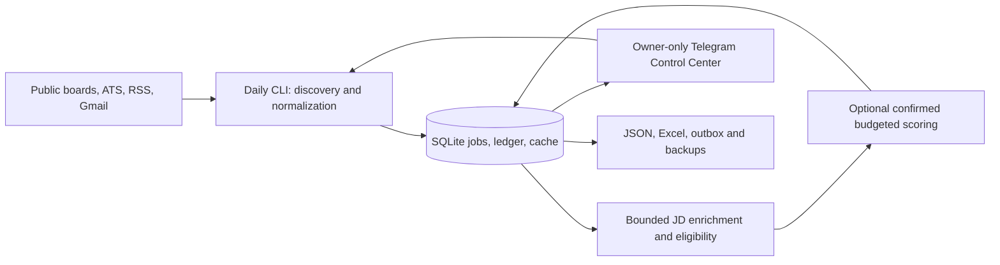

# Job Radar

Job Radar finds and tracks IT vacancies in Vienna and Austria for junior and
working-student candidates. It prefers 20–25 hours/week (15–30 acceptable), Vienna
on-site/hybrid and explicitly supported Austria-remote work. The Telegram Control
Center is the daily interface; SQLite is the source of truth. No action submits
an application automatically.

This branch is the integrated v2 release candidate. The package version remains
1.1.0 until a reviewed release. **Live production startup is blocked pending
credential rotation/revocation and owner acceptance.** Offline and read-only
public collection do not require those credentials. See [RC validation and
recovery](docs/RELEASE_CANDIDATE_V2.md).



## macOS setup and first safe search

Use Python 3.11+ (Ubuntu CI uses 3.12). Start in this checkout. These commands use a
separate runtime and database; existing private files are preserved by setup.

```bash
export JOB_RADAR_CACHE_DIR="${XDG_CACHE_HOME:-$HOME/.cache}/job-radar-v2-rc"
./scripts/setup.sh --no-browser
[ -f data/.env ] || cp .env.example data/.env
chmod 600 data/.env
./bin/job-radar init-db --database data/rc-acceptance.db
./bin/job-radar health --database data/rc-acceptance.db
./bin/job-radar daily --database data/rc-acceptance.db --output outputs/rc-acceptance \
  --no-email --transport http --pages 1 --limit 2 --details 0 --enrich-limit 3 --score-limit 0
```

Inspect `outputs/rc-acceptance/report.json`, `vacancies.json`, `vacancies.xlsx`
and `telegram-preview.txt`. A partial run exits 1 after preserving usable data.
`enrichment-report --all --json` exposes JD quality separately from not attempted,
retry scheduled/due/exhausted and supplied descriptions. Set `JOB_RADAR_DB` or use
explicit database paths consistently. Only use the authoritative DB after the
migration procedure in the [RC runbook](docs/RELEASE_CANDIDATE_V2.md).

## Telegram and AI

After rotation and authorization, fill `TELEGRAM_BOT_TOKEN`, numeric
`TELEGRAM_OWNER_ID` and matching private `TELEGRAM_CHAT_ID` in `data/.env`.
Do not paste tokens into Git, shell history or reports. Then:

```bash
./bin/job-radar telegram-check                 # read-only API check, no test message
./bin/job-radar health --database data/rc-acceptance.db --require-telegram
./bin/job-radar telegram-poll --database data/rc-acceptance.db --transport http
```

Open the bot's private chat and enter `/start`. Ukrainian is the default; German
and English are available. Dashboard, browse/search filters, source and JD states,
job details, Save/Skip/Applied/Interview/Offer/Rejected/Withdrawn use the database.
Viewing a job never acknowledges a digest. Search completion is announced once;
unknown sends are held for inspection. Ctrl-C stops the poller and its local
search supervisors. Use one poller per bot and one scheduler per DB.

- **Quick Search** runs the integrated `daily` pipeline, with up to three JD
  requests by default, deterministic filtering, zero AI, no Gmail or digest.
- **Full Search** uses the same pipeline and existing scoring engine. Configure
  a verified profile/model/key and positive `JOB_RADAR_AI_RUN_BUDGET_USD` and
  `JOB_RADAR_AI_DAY_BUDGET_USD` to enable it. Before launching, the bot shows the
  conservative reservation estimate and both caps and requires confirmation.
  Default maximum is two score attempts; cache hits do not spend. SQLite reserves
  a conservative cost before each call, including possible retries, and retains
  reservations on failures. Estimates use configured prices; set a separate
  provider account budget. There are no automatic drafts or individual paid
  card actions.
- Scheduled collection and Telegram searches share `.run.lock`. Scheduled
  digests are opt-in, separate from search completion messages. An acknowledged
  daily outbox is never resent on a repeated run. `--telegram` is a real send;
  `--score-limit N` with a configured provider is an intentional paid CLI action.

## Configuration and source limits

Shell environment takes precedence over `.env`, then `data/.env`. Use
[.env.example](.env.example) as a blank starting point. Setup creates editable
`data/searches.yaml` and `data/candidate_profile.yaml` when absent.

| Setting | Purpose |
| --- | --- |
| `JOB_RADAR_DB` | Shared authoritative SQLite path for daily, bot and applications |
| `JOB_RADAR_CANDIDATE_PROFILE` | Verified candidate facts; never infer qualifications |
| `--searches PATH` | One to eight public profiles; optional `title_terms`/`location_terms` filters |
| `JOB_RADAR_ENRICH_FRESHNESS_HOURS`, `JOB_RADAR_ENRICH_RETRY_HOURS` | Default 72h refresh, 24h base retry |
| `JOB_RADAR_ENRICH_TIMEOUT`, `JOB_RADAR_ENRICH_RATE_LIMIT`, `JOB_RADAR_ENRICH_RETRIES` | HTTP bounds |
| `JOB_RADAR_CREDENTIALS`, `JOB_RADAR_TOKEN` | Optional readonly Gmail OAuth setup; see [operations](docs/OPERATIONS.md) |
| `OPENAI_API_KEY`, `OPENAI_MODEL`, `OPENAI_*` | Optional scoring credentials, prices and token/time limits |
| `JOB_RADAR_AI_RUN_BUDGET_USD`, `JOB_RADAR_AI_DAY_BUDGET_USD` | Full Search reservation caps, default zero |
| `TELEGRAM_BOT_TOKEN`, `TELEGRAM_OWNER_ID`, `TELEGRAM_CHAT_ID` | Private owner-only bot credentials |

Default profiles cover LinkedIn/karriere.at. [Opt-in sources](searches.collection-v2.example.yaml)
include Absolventen RSS (disabled by default because the feed is broad) and verified
Greenhouse/Lever employer boards, with local technical/location filters. Feed
snapshots are not exhaustive Austria searches. Details may be inaccessible or
expired. LinkedIn 429 stops same-source profiles during a persisted cooldown;
other sources continue. No challenge bypass or invented JD. DevJobs, StepStone,
AMS and WeAreDevelopers remain unsupported; see [source evidence](docs/COLLECTION_V2.md).
Run setup without `--no-browser` only if you intend to use the optional Playwright
transport on permitted pages.

## State, backups and troubleshooting

```bash
./bin/job-radar backup --database data/rc-acceptance.db --output backups/rc
JOB_RADAR_DB=data/rc-acceptance.db ./bin/job-radar enrichment-report --all --json
./bin/job-radar --help
make check
```

SQLite WAL and busy timeout are enabled. Manual backups use SQLite's backup API
and include the Telegram sidecar if present; stop writers for a paired restore
snapshot. `init-db` backs up an existing database before additive migration.
Never copy only the main file of a live WAL database or point a test at live state.
Unknown notification sends require operator inspection before recovery.

If no jobs are recommended, inspect hours, technical role and work-location
reasons in `vacancies.json`; unknown hours are review, explicit full-time-only
jobs are incompatible, and salary on full-time basis is not an hours requirement.
For health/source failures inspect `report.json`, `health` and the attempt report.
For owner mismatch, verify the numeric private chat settings without printing
secrets. The control sidecar is private; preserve it when migrating the bot.

[Ubuntu systemd setup, migration, rotation, validation and recovery](docs/RELEASE_CANDIDATE_V2.md)
contains the deployment procedure. No host was deployed during RC development.
Detailed [Telegram operations](docs/TELEGRAM_CONTROL_CENTER.md), [collection engine](docs/COLLECTION_V2.md),
[application policy](docs/APPLICATION_PRIORITY.md), [legacy commands](docs/OPERATIONS.md)
and [historical release notes](docs/RELEASE_v1.1.0.md) remain available.

### Telegram v3 reliability increment

The `feat/telegram-experience-v3` branch adds independent callback acknowledgement,
content-free latency telemetry, rate-limit cooldowns and context-preserving filter
navigation. This is a partial v3 delivery; Candidate Intelligence and the Mini App
are not implemented yet. See the [Ukrainian implementation report, benchmarks and
acceptance commands](docs/TELEGRAM_EXPERIENCE_V3.md).
