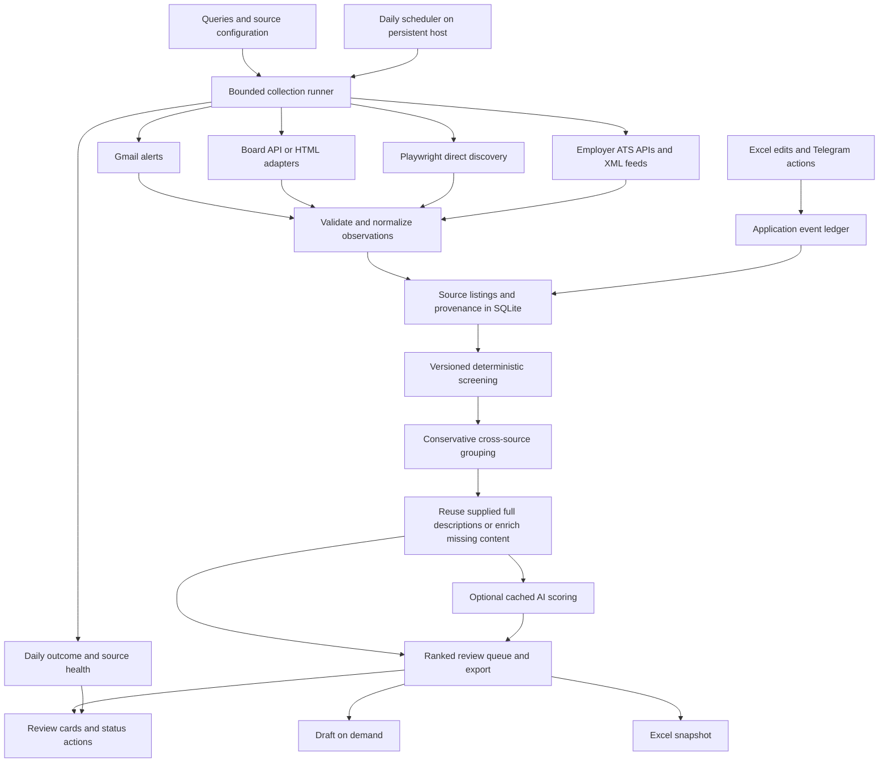

# Multi-source MVP architecture

Design update: 2026-11-04. **Target design; not yet implemented.**
Implementation checkpoints are tracked in [PROGRESS.md](PROGRESS.md); a standalone
multi-source daily cycle now covers bounded collection, descriptions, persistence,
Excel, application events and optional Telegram. See [OPERATIONS.md](OPERATIONS.md)
for implemented commands. This document still contains future target elements,
including durable cursors, stable group aliases and unattended deployment.
Current runtime and audit evidence: [MVP_AUDIT.md](MVP_AUDIT.md).
Source-specific evidence: [SOURCES.md](SOURCES.md).
V1 operating contract: [MVP_V1.md](MVP_V1.md).

## Decision

Keep one Python application, SQLite, and the existing CLI. Add a connector boundary
for discovery; keep description enrichment separate. Email and direct collection
are two independently scheduled acquisition paths, both attempted on every daily
run. Neither waits for the other to fail. Reuse libraries behind adapters.
Playwright is an available V1 transport for browser-based sources. SQLite owns
vacancy and application history; Excel provides a review snapshot plus explicit
status-edit import. Autonomous hosting and daily Telegram reporting are V1
requirements, not deferred automation work.
No Redis, Celery, separate microservices, vector database, or browser fleet is
needed for one person's daily search.

## Connector contract

Proposed modules: `sources/base.py`, `sources/gmail.py`, `sources/karriere.py`,
`sources/jobspy.py`, `sources/ats/`, and `collection.py`.
Existing `parsers/` remains deterministic parsing, not fetching.
Browser lifecycle, timeouts and diagnostics live in a shared Playwright transport;
selectors and board-specific navigation remain in their source adapters.

`SourceConnector.collect(query, checkpoint, budget) -> CollectionBatch`
performs a bounded unit of work. No connector writes SQLite, screens jobs, calls
an LLM, or sends notifications. Dependencies are injected for fixture testing.

Each batch contains:

- `observations`: validated source-neutral records.
- `next_checkpoint`, `complete`, `outcome`: `success`, `partial`, `blocked`,
  `rate_limited`, `failed`, or `unsupported`.
- Structured errors and warnings, including individual malformed records;
  fetched/parsed counts and duration. An empty successful result is distinct from
  a blocked page, a parser failure, and an incomplete scan.

Each observation contains:

| Field | Meaning |
| --- | --- |
| `source`, `source_job_id` | Origin board/ATS and native identity; preserve the existing LinkedIn/Indeed keys across email and JobSpy. |
| `connector`, `connector_version`, `query_id` | Acquisition route and reproducibility, separate from origin. |
| `source_url`, `apply_url` | Sanitized public listing and optional original employer application URL. Preserve functional job IDs. |
| `title`, `company`, `location_raw` | Source text; missing fields stay unknown. |
| `country`, `city`, `workplace_type` | Normalized location and onsite/hybrid/remote classification, with unknown allowed. |
| `published_at`, `observed_at` | Source publication time if known and collection time as UTC; neither substitutes for email receipt. |
| `snippet`, `description`, `description_kind` | Distinguish full description from truncated snippet; carry parsing method/confidence. |
| `employment_type`, `hours_min/max`, `language` | Optional evidence useful for student and part-time roles. |
| `salary_min/max`, `salary_currency/period`, `salary_is_estimated` | Preserve source period, lower-bound nature, and estimates; do not assume twelve Austrian monthly payments. |
| `availability`, `availability_checked_at` | Active/expired/unknown per source listing; transport failure is not expiry. |

ATS keys include tenant: `greenhouse:<board_token>:<id>`,
`personio:<tenant>:<id>`, etc. Third-party providers retain origin IDs when verified;
otherwise use a provider namespace and retain origin separately. Synthetic fallback
IDs must be marked and must not pretend to be native IDs.

## Persistence and identity

Use additive migrations and a database backup before implementation rollout.

1. Retain `jobs` as the source-listing store initially. Add generic timestamps,
   acquisition metadata, structured location, and listing lifecycle fields.
   Keep existing email columns for compatibility; API sources must not invent
   Gmail IDs or email dates.
2. Add `source_observations` for provenance: listing key, connector/query/message
   reference, observed time, normalized payload hash, parser version, and quality.
   Store normalized job data only; no raw emails or unfiltered account payloads.
3. Add `source_query_state`, keyed by connector + normalized query/config version,
   with durable checkpoint, last successful time, retry time, failure streak, and
   source diagnostics. Never advance a checkpoint before its batch commits.
4. Separate stable `vacancy_groups.id` from a recalculable matching fingerprint;
   keep group memberships and identity aliases. Start with existing semantic IDs
   as group IDs so scores, drafts, Telegram callbacks, and applied/skipped history
   continue to resolve. Future merges retain aliases; do not silently rewrite
   foreign identities or discard historical records.
5. Keep existing score/draft caches; use effective description content and stable
   vacancy identity as inputs. Freshness checks alone do not require new AI calls.
6. Add a separate `application_events` ledger and current application state keyed
   by candidate + stable vacancy ID. Do not use Telegram delivery state as the
   application ledger. Source updates, reposts and group merges must preserve
   application history and expose uncertain prior-application matches.
7. Add `notification_outbox` and workbook import/export metadata. Notifications
   are durable work; workbook snapshots carry schema version, export time and
   per-vacancy application revision. See the V1 contract for conflict handling.

For grouping, first use native source IDs, verified shared employer requisition
IDs, and canonical employer URLs. Otherwise require sufficiently complete company,
title, and normalized location. `Wien`/`Vienna` are aliases; missing company/location
is not evidence of sameness. Keep uncertain matches separate for review.

## Reliability and lifecycle

- Commit batches independently; isolate source failures. Preserve valid records
  from partial pages and retry incomplete work idempotently. One failed connector
  cannot prevent others or downstream processing of stored vacancies.
- Use per-query checkpoints with a proposed 72-hour overlap and explicit backfill
  after longer downtime. Persist seen-at separately from content-updated-at.
- Define limits for pages, items, duration, retries, and provider spend per run.
  Count all query pages against one budget. Stop when pagination repeats.
- Initial policy proposal: HTTP concurrency one per host, at least two seconds
  between requests, honor `Retry-After`, durable cooldown on 429/blocking. Make
  these per-source settings; do not use one default for all providers.
- Prefer documented API/feed when available; choose direct HTTP or Playwright
  per board based on retrieval quality and maintenance. Playwright can render
  pages, navigate pagination and read visible DOM or structured data in V1.
  BeautifulSoup is optional for parsing retrieved HTML, not a required second
  browser stack. The direct path must discover vacancies without email input.
- Give each browser task a hard deadline and always close contexts/pages in
  cleanup. Isolate browser failures from Gmail, database writes and digest work.
  Persist browser-session state privately only when needed; expired login or a
  challenge becomes a typed source failure with an action in the daily report.
- A published frontend endpoint is not automatically a supported public API.
  Record access requirements and current source terms before enabling a connector.
- Initial freshness proposal: revalidate shortlisted active descriptions after
  24 hours, other active descriptions after 72 hours; keep last good content if
  transient retrieval fails, but mark freshness unknown. Use ETag/Last-Modified
  where provided. Support explicit refresh.
- An alert, truncated search, or failed page cannot prove a vacancy closed.
  Prefer explicit source closure; snapshot absence is evidence only after a
  complete successful scan of the relevant authoritative scope.
- A closed duplicate does not close an active employer listing. Prefer recent
  verified active records; retain unknown candidates for review. Track expiry per
  source and use one shared policy for scoring, queue, export, and delivery.
- Screen records with missing/failed/outdated rules versions even if source content
  is unchanged. Re-screen when new full requirements change relevant evidence.
- Source-supplied full descriptions bypass redundant detail fetching. An AI failure
  must not block the deterministic review queue; a draft failure must not block a
  score card. Generate drafts on demand after review by default.
- Report per source: fetched/parsed/invalid/new/changed/duplicate counts, last
  success, freshness, blocked/rate-limited errors, and cost. Measure unique useful
  vacancies added beyond existing sources, not raw result count.

## Incremental delivery

1. **Reliability:** shared source/group availability policy, freshness and refresh,
   rules-version rescreening. Add regressions for active + expired duplicates,
   old successful cache entries, transient failures, and unchanged outdated rules.
2. **Source boundary:** generic observation/batch models, Gmail adapter, registry,
   per-query state and partial-failure handling. Keep current commands compatible;
   storage persists service results rather than running domain rules itself.
3. **First extra source:** karriere.at discovery/detail prototype, fixtures and
   pagination/empty/blocked/malformed tests, bounded live smoke check, then enable.
   Use Playwright where appropriate. Keep email ingestion independent; an email
   fallback alone does not satisfy direct discovery acceptance.
4. **Reuse:** optional JobSpy adapter for LinkedIn/Indeed; preserve email source
   keys, validate native IDs, represent partial failures explicitly. Pin the
   tested library version; avoid making it a required dependency of Gmail runs.
5. **Coverage:** employer watchlist with Personio/Greenhouse/Lever/Ashby, then
   evaluate DEVjobs, jobs.at, AMS, and StepStone by incremental useful coverage.
   Trial Adzuna if an API key and Austrian coverage are confirmed.
6. **Control:** independent application ledger, duplicate/prior-application
   checks, Excel snapshot and validated edits, score-card delivery without drafts.
7. **V1 deployment:** persistent host/storage, daily scheduler, callback worker,
   durable notifications, backups/restore, health alerts and seven-day unattended
   acceptance. Later V2 adds broader agent access and application automation.

Proposed CLI additions such as `collect --sources ...`, `source-status`, and
`enrich --refresh` are design targets, not commands available today.
Excel import/export and autonomous scheduling are also target behavior, not
features added by this documentation update.

Acceptance: existing 89-test behavior remains compatible except deliberately
updated lifecycle expectations; fixtures cover each new layout; a failed source
does not erase successful batches; replay creates no duplicate source jobs; source
full descriptions avoid extra detail requests; historical statuses survive
migration; private inputs and tokens stay out of Git/logs/exports. Test migrations
on a copied database before rollout.
